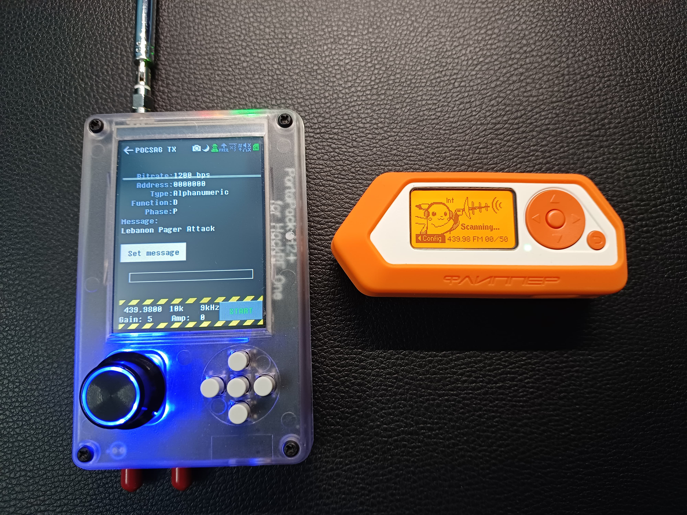
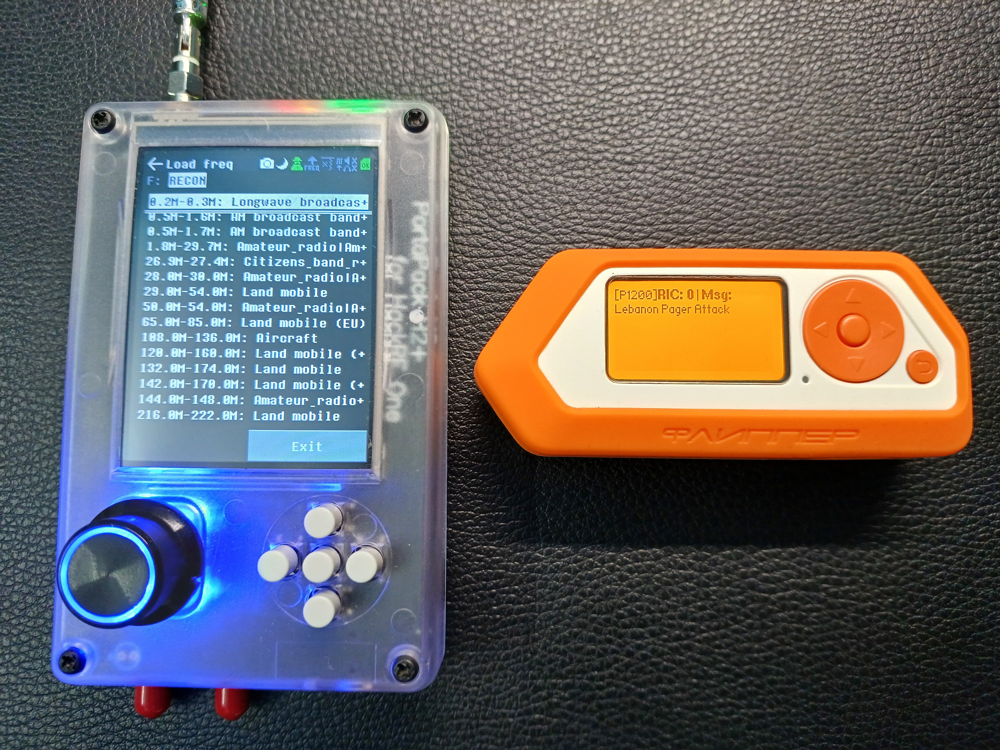
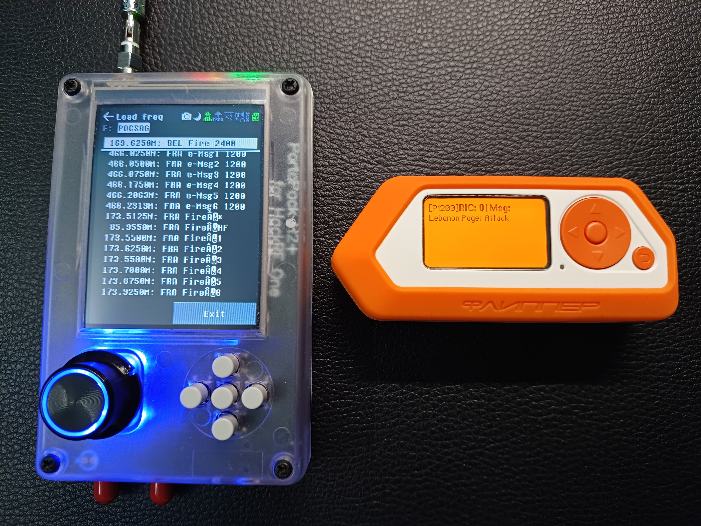
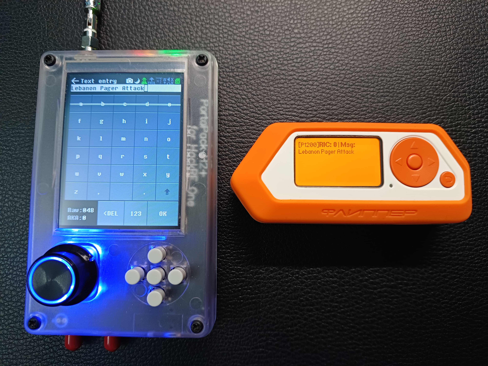
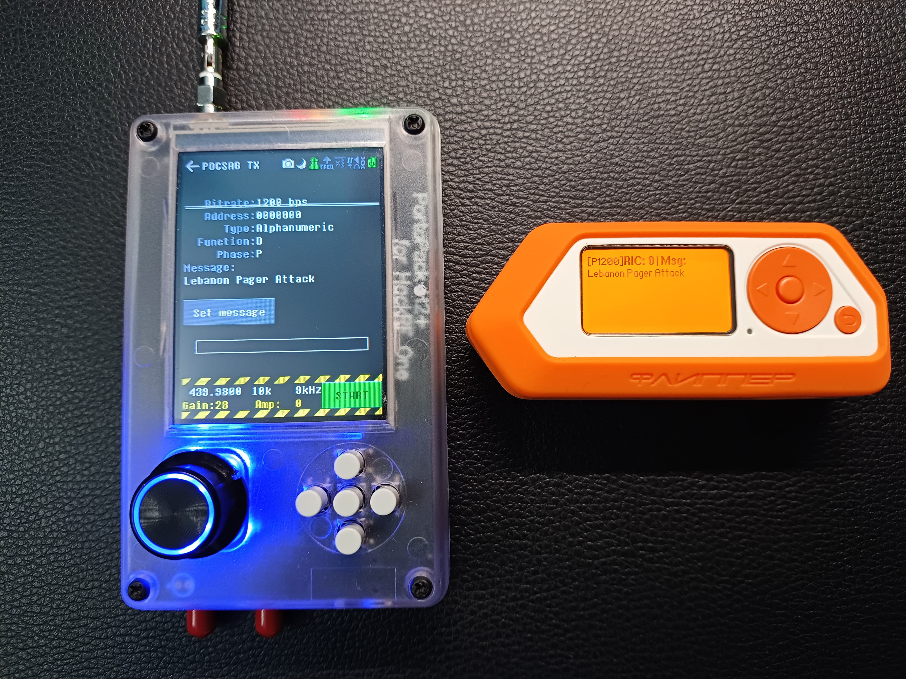
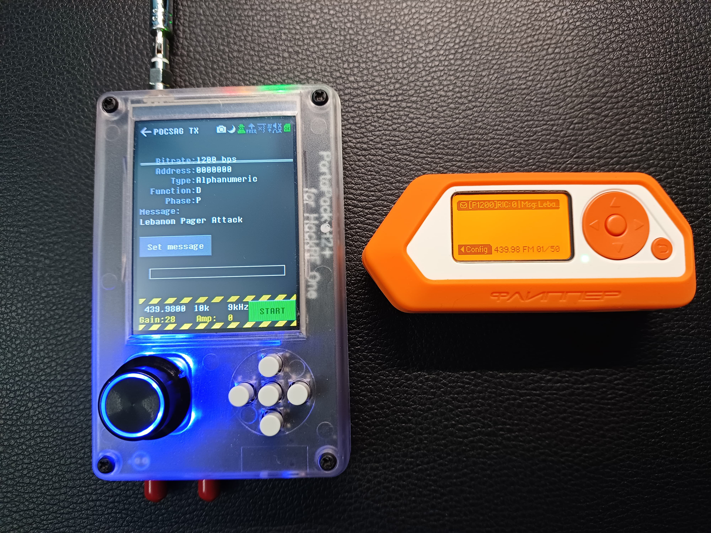

# POCSAG RF Message Injection — Proof of Concept

> A controlled, educational reconstruction of the attack vector behind the September 2024 Lebanon pager incident: **unauthenticated, unencrypted message injection into legacy POCSAG pager infrastructure** using commodity Software-Defined Radio (SDR) hardware.

<p align="left">
  
  
  
  
  
</p>

---

## ⚠️ Legal & Ethical Notice — Read First

This repository is **documentation of security research conducted for educational purposes only.** It exists to demonstrate why unauthenticated broadcast paging protocols are unsafe for critical communications, and to argue for their replacement.

- **No weaponization.** Nothing here relates to, or instructs on, causing physical harm to people or devices. The "detonation" context of the 2024 incident is referenced only as the real-world motivation for studying the *signalling* vulnerability. This project concerns **RF message injection and reception**, nothing more.
- **Transmitting on licensed spectrum is regulated.** Operating a transmitter on UHF bands (incl. 430–450 MHz) without an appropriate licence or authorisation is **illegal in most jurisdictions.** Any transmission demonstrated here must only be reproduced inside a **shielded RF enclosure / dummy load / Faraday environment** or under a valid licence, on frequencies you are authorised to use, with no third-party pagers in range.
- **Do no harm to third parties.** Never transmit on, spoof, or interfere with frequencies used by medical, emergency, military, or any live operational paging service.
- **You are responsible.** By reading or reusing this material you accept that you alone are liable for your actions. See [`DISCLAIMER.md`](DISCLAIMER.md).

The author does **not** publish exact TX payloads, target RIC addresses, or turn-key transmission recipes. The intent is to make the *risk* legible to defenders and regulators — not to lower the barrier for abuse.

---

## 📋 Table of Contents

1. [Summary](#-summary)
2. [Why This Matters](#-why-this-matters)
3. [The POCSAG Weakness in One Paragraph](#-the-pocsag-weakness-in-one-paragraph)
4. [Hardware & Firmware](#-hardware--firmware)
5. [Methodology](#-methodology-high-level)
6. [Walkthrough & Evidence](#-walkthrough--evidence)
7. [Demo Video](#-demo-video)
8. [Findings](#-findings)
9. [Mitigations & Defensive Takeaways](#-mitigations--defensive-takeaways)
10. [Repository Structure](#-repository-structure)
11. [Documentation](#-documentation)
12. [Skills Demonstrated](#-skills-demonstrated)
13. [References](#-references)
14. [License](#-license)

---

## 🎯 Summary

In September 2024, thousands of pagers across Lebanon and Syria were weaponised in a coordinated operation widely attributed to Israeli intelligence. The incident put a decades-old question back under the spotlight: **how trustworthy is the paging infrastructure that hospitals, emergency services, and industrial sites still rely on?**

This project reconstructs — in a controlled bench environment — the *communications* half of that question: the fact that **POCSAG paging messages are transmitted in plaintext with no authentication, integrity, or encryption.** Using an SDR transmitter and a separate SDR receiver, the research demonstrates that a crafted pager message can be injected and received as if it were legitimate.

| | |
|---|---|
| **Target protocol** | POCSAG (Post Office Code Standardisation Advisory Group) |
| **Band studied** | UHF 430–450 MHz |
| **TX platform** | HackRF One + PortaPack H2+ (Mayhem firmware) |
| **RX / recon platform** | Flipper Zero (RogueMaster firmware) |
| **Modulation** | 2-FSK, 512 / 1200 bps |
| **Outcome** | Confirmed that injection is unauthenticated, unencrypted, and immediately decodable |

---

## 💡 Why This Matters

Paging networks are not a relic. They remain in active use in:

- **Healthcare** — hospital crash-call and on-call systems
- **Emergency services** — fire/EMS dispatch
- **Industrial & critical infrastructure** — SCADA alerting, lone-worker safety
- **Military & government** — legacy alerting channels

The appeal of paging — long range, excellent building penetration, simplicity — is exactly what makes it hard to retire. But the protocol predates any serious consideration of integrity or authenticity. A receiver has **no way to tell a genuine message from a forged one.** That is a systemic risk, not a device bug.

---

## 🔑 The POCSAG Weakness in One Paragraph

POCSAG frames a message as a preamble, a synchronisation codeword, and batches of address + message codewords protected only by a **BCH(31,21) error-correcting code and a single parity bit.** That ECC exists to survive noise — **not** to resist tampering. There is no sender identity, no shared secret, no signature, and no sequence protection. Any transmitter on the right frequency, bitrate, and RIC can emit a frame that every pager in range will accept and display. See [`docs/04-pocsag-primer.md`](docs/04-pocsag-primer.md) for the protocol breakdown.

---

## 🛠 Hardware & Firmware

| Role | Device | Firmware | Notes |
|------|--------|----------|-------|
| Transmit | **HackRF One + PortaPack H2+** | **Mayhem** | Native on-device POCSAG TX application; standalone, no PC required |
| Receive / Recon | **Flipper Zero** | **RogueMaster** | Sub-GHz scanning and POCSAG decode in the UHF range |
| Antennas | UHF-tuned whips | — | Kept at minimum power, bench distance |

Full rationale and setup notes: [`docs/02-hardware-setup.md`](docs/02-hardware-setup.md).

---

## 🧪 Methodology (High Level)

The exercise followed a classic **recon → craft → transmit → verify** signals workflow, intentionally described at a conceptual level:

1. **UHF reconnaissance** — sweep the 430–450 MHz band with the Flipper Zero to characterise activity and confirm a POCSAG-bearing channel.
2. **Channel identification** — isolate a candidate paging channel and note its modulation and bitrate.
3. **Message crafting** — compose a benign test payload within the PortaPack POCSAG TX module (frequency, bitrate, RIC, body).
4. **Controlled injection** — transmit the test frame at minimum viable power in an isolated environment.
5. **Reception & verification** — independently receive and decode the frame on the Flipper Zero to prove the message was accepted without any authentication challenge.
6. **Variant testing** — repeat with different message types to characterise repeatability.

The step-by-step reasoning (and the controls that keep it lawful) is in [`docs/03-methodology.md`](docs/03-methodology.md).

---

## 📸 Walkthrough & Evidence

| # | Stage | Screenshot |
|---|-------|-----------|
| 1 | UHF band reconnaissance sweep (Flipper Zero) |  |
| 2 | Loading the recon band plan |  |
| 3 | POCSAG frequency / channel list |  |
| 4 | Crafting a benign test message |  |
| 5 | POCSAG TX module (controlled injection) |  |
| 6 | Message received & decoded on the second radio |  |

---

## 🎥 Demo Video

A short end-to-end capture of the bench demonstration is committed to this repository:

**▶️ [`assets/video/demo.mp4`](assets/video/demo.mp4)**

> GitHub shows repository `.mp4` files as a download/preview link rather than an inline player. To get an embedded player at the top of this section, open this README in the GitHub web editor and **drag the video file into the editor** — GitHub will replace the placeholder below with a hosted `user-attachments` URL.

<!-- DEMO_ATTACHMENT: drag assets/video/demo_attachment.mp4 into the GitHub web editor here to embed the short (<10 MB) demo inline. The file is included in the repo for convenience. -->

---

## 📊 Findings

| # | Finding | Evidence |
|---|---------|----------|
| F-1 | POCSAG messages are broadcast **in plaintext** | Decoded cleanly on an independent receiver |
| F-2 | There is **no authentication** of the sender | A non-network transmitter's frame was accepted |
| F-3 | There is **no integrity/anti-replay guarantee** | Crafted frames were indistinguishable from legitimate ones to the receiver |
| F-4 | The attack needs only **commodity, low-cost hardware** | Entire chain built from off-the-shelf SDR gear |
| F-5 | Injection is **immediate and repeatable** | Multiple message variants reproduced on demand |

**Conclusion:** Legacy broadcast paging offers no technical basis for trusting a received message. Where paging carries safety-critical information, that trust gap is a material risk.

---

## 🛡 Mitigations & Defensive Takeaways

- **Treat paging as unauthenticated by design.** Never let a pager message *alone* trigger an irreversible or safety-critical action; require out-of-band confirmation.
- **Add an application-layer integrity envelope** (signed/HMAC payloads) where pagers cannot be replaced, so forged messages fail validation even if the RF layer does not.
- **Migrate critical alerting to modern, encrypted, authenticated transports** where feasible.
- **Monitor the spectrum.** Anomaly detection on your own paging channels can surface rogue transmitters.
- **RF risk assessments** belong in red-team scopes for healthcare, emergency, and OT/ICS environments.

Expanded guidance: [`docs/05-mitigations.md`](docs/05-mitigations.md).

---

## 🗂 Repository Structure

```
.
├── README.md                     # This file
├── LICENSE                       # MIT License
├── DISCLAIMER.md                 # Legal & ethical terms (binding)
├── .gitignore
├── CITATION.cff                  # How to cite this work
├── docs/
│   ├── 01-background.md          # The 2024 Lebanon incident & context
│   ├── 02-hardware-setup.md      # Devices, firmware, bench setup
│   ├── 03-methodology.md         # Recon → craft → TX → verify (with controls)
│   ├── 04-pocsag-primer.md       # How POCSAG works & why it is insecure
│   └── 05-mitigations.md         # Defensive recommendations
└── assets/
    ├── screenshots/              # Annotated evidence (6 images)
    │   ├── demo-01-uhf-recon-scan.jpg
    │   ├── demo-02-recon-band-plan.jpg
    │   ├── demo-03-pocsag-frequency-list.jpg
    │   ├── demo-04-message-crafting.jpg
    │   ├── demo-05-pocsag-tx-inject.jpg
    │   └── demo-06-message-received.jpg
    └── video/
        ├── demo.mp4              # End-to-end bench demonstration (committed)
        └── demo_attachment.mp4   # Short clip to drag-embed inline in the README
```

---

## 📚 Documentation

| Document | Purpose |
|----------|---------|
| [`docs/01-background.md`](docs/01-background.md) | Real-world context: the 2024 Lebanon pager incident |
| [`docs/02-hardware-setup.md`](docs/02-hardware-setup.md) | Hardware, firmware, and bench environment |
| [`docs/03-methodology.md`](docs/03-methodology.md) | The research workflow and the controls that keep it lawful |
| [`docs/04-pocsag-primer.md`](docs/04-pocsag-primer.md) | POCSAG frame structure and the root of its insecurity |
| [`docs/05-mitigations.md`](docs/05-mitigations.md) | Defensive recommendations for operators |
| [`DISCLAIMER.md`](DISCLAIMER.md) | Binding legal and ethical terms |

---

## 🧰 Skills Demonstrated

`SDR` · `POCSAG` · `Wireless Protocol Analysis` · `RF Reconnaissance` · `Signals Intelligence (SIGINT)` · `HackRF One` · `PortaPack / Mayhem` · `Flipper Zero / RogueMaster` · `UHF Band Monitoring` · `Offensive Security Research` · `Critical-Infrastructure Threat Modelling` · `Responsible Disclosure`

---

## 🔗 References

- POCSAG / Radio Paging Code No. 1 — ITU-R M.584 recommendation
- Mayhem firmware for HackRF PortaPack — community SDR project
- RogueMaster firmware for Flipper Zero — community sub-GHz project
- Public reporting on the September 2024 Lebanon pager incident

> External links and tooling are referenced for educational attribution only; see [`docs/01-background.md`](docs/01-background.md).

---

## 📄 License

Released under the [MIT License](LICENSE) for the **documentation, text, and media** in this repository. The license does not grant permission to transmit on regulated spectrum or to act unlawfully — see [`DISCLAIMER.md`](DISCLAIMER.md).

---

<sub>Built as an independent security-research portfolio project. Educational use only.</sub>
